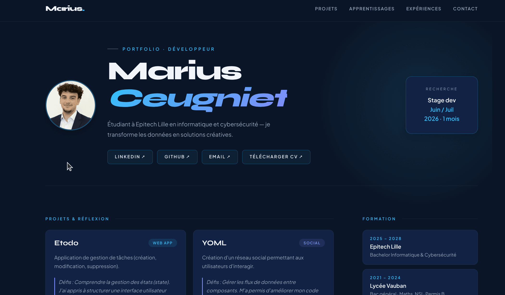

# 🌐 Mon Portfolio Personnel

Bienvenue sur le dépôt GitHub de mon portfolio en ligne ! C'est ici que je rassemble mon parcours, mes compétences et mes différents projets.

🔗 **Voir le site en direct :** [portfolio-ceugniet-marius.vercel.app](https://portfolio-ceugniet-marius.vercel.app/)

---

## 📸 Aperçu du site



---

## 🚀 À propos de moi

Moi c'est **Marius Ceugniet**. Actuellement étudiant à **Epitech Lille (Promo 2028)** en Bachelor Informatique & Cybersécurité, je me spécialise en **Développement Logiciel** avec un très fort intérêt pour l'**Intelligence Artificielle** et le **Machine Learning**.

Ce portfolio est ma vitrine pour partager mes créations, mon évolution technique et toutes mes expérimentations avec le code.

## 🛠️ Technologies utilisées

Pour développer et mettre en ligne ce site, j'ai utilisé :
- **Frontend :** React.js propulsé par Vite
- **Langages et Stylisme :** JavaScript, HTML5, CSS3
- **Polices :** Unbounded et IBM Plex, auto-hébergées via Fontsource
- **Déploiement :** [Vercel](https://vercel.com/)

## 📂 Contenu du projet

Le site est structuré en plusieurs sections :
- 🧑‍💻 **Accueil :** présentation, recherche de stage en cours et une petite scène d'alunissage animée (clin d'œil au projet Start Trek).
- 💻 **Projets :** 11 projets filtrables (IA & data, Web, Sécurité, Jeu) : Start Trek, Codename, Persona, Dr CVRIE, Tardis, Etodo, Chatbot & LLM, Hack And Juice, YOML, Puissance 4 et ce portfolio. Chaque projet se déplie pour montrer le défi, ce que j'ai fait et la stack.
- 📈 **Ce que j'ai appris :** mon évolution technique et mes activités au Hub Epitech.
- 🎓 **Parcours :** formation et expériences professionnelles sous forme de frise.
- 🛠️ **Compétences :** IA & data, web, outils, langues et centres d'intérêt.
- ✉️ **Contact :** email, LinkedIn, GitHub, CV téléchargeable et formulaire qui prépare un email.

✏️ **Tout le contenu se modifie dans `src/data.js`**, sans toucher au reste du code.

## ⚙️ Installation locale

Si tu souhaites lancer ce projet sur ta machine :

1. Clone le dépôt :
```bash
git clone https://github.com/klasken/Portfolio.git
```

2. Accède au dossier :
```bash
cd Portfolio
```

3. Installe les dépendances :
```bash
npm install
```

4. Lance le serveur de développement :
```bash
npm run dev
```

Le site sera accessible sur [http://localhost:5173](http://localhost:5173)
